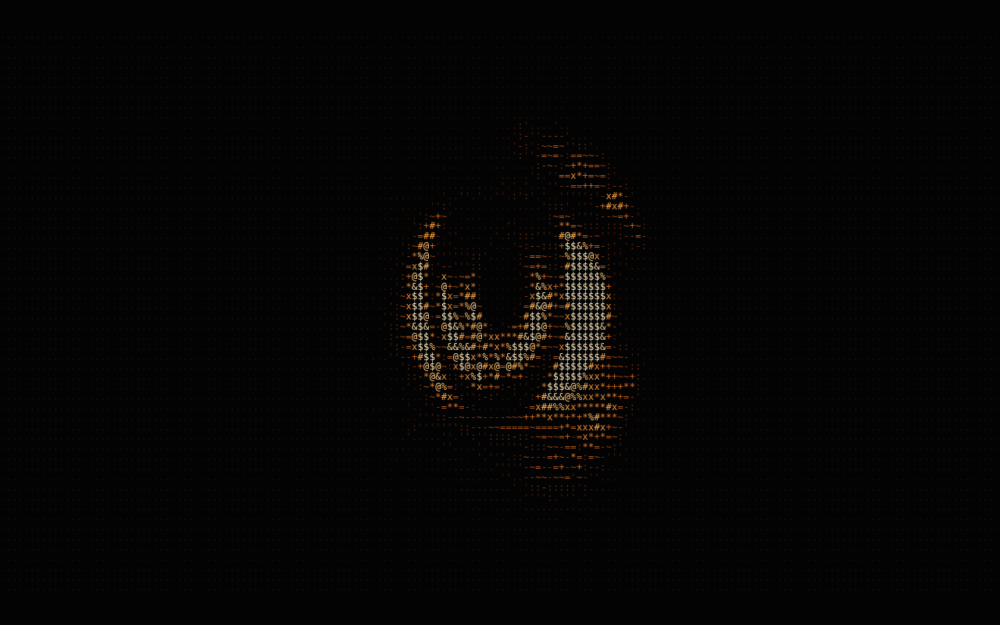

<div align="center">

# ascii flow

**A picture rebuilt in ASCII characters that slowly melts into a heart, and back.**


**[Live demo →](https://mtarvecha660-lgtm.github.io/ascii-flow/)**



</div>

---

## ✨ What it does

- Draws an embedded picture on a full-screen canvas as a grid of characters, choosing each character by how bright that part of the picture is.
- Morphs the grid between the picture and a heart on a **16-second loop**, with a diagonal wave, a little per-cell jitter and a light shimmer.
- Fits any window: the grid is laid out for 1280×720 and gets coarser on smaller screens.

## 🚀 Run it

There is no build step and no dependencies.

```bash
git clone https://github.com/mtarvecha660-lgtm/ascii-flow.git
cd ascii-flow
open index.html        # Windows: start index.html · Linux: xdg-open index.html
```

Or just open the [live demo](https://mtarvecha660-lgtm.github.io/ascii-flow/).

## 🧩 How it works

Everything is in one file, `index.html`:

- The picture is a base64 JPEG in the `IM.src` line. Replace that data URI to use a different image.
- Each cell's brightness comes from the picture; the heart is a fixed equation drawn on the same grid.
- Every frame, each cell is drawn with `fillText`, coloured along a dark-to-cream gradient (picture) or a rose gradient (heart).

## 🛠️ Tech stack

HTML5 Canvas 2D · vanilla JavaScript · inline CSS

## ⚠️ Status and limitations

- It is a visual piece: no controls, no interaction, no sound.
- The loop length, wave and colours are constants in the code; there is no settings panel.
- The picture lives inside the file, so changing it means editing the data URI.
- Not tested on phones or low-end hardware.
